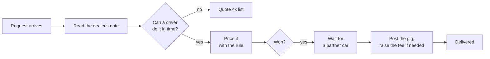

# Spread: pricing car deliveries like a market maker

Team ABQuant's bot for the Bahn Express **Spread** challenge at Junction 2026.

Car dealers ask for a price to move a car. A hidden competitor quotes too, and the dealer takes the better offer. For
every car we win we must find a freelance driver and pay them. The score is the margin over one simulated week, and a
team with fewer than 90% of its cars on time is not ranked at all.

We treated it as a market-making problem: the dealer is the counterparty, the competitor's price is the mid, and
drivers are the inventory that runs out. One rule prices every request.

**Result:** 17,130 margin in the final, 463 cars, 94.4% on time, **25th of 58 ranked teams**. For scale, the
organisers' own system makes about 12,850 a week and the kit's starter loses 72,613.

## The problem

- **Two hidden things.** We never see the competitor's price or what a driver would accept. We see only our own wins,
  losses and bookings.
- **A hard floor.** Under 90% on time the week does not count. A late car costs a refund and halves that dealer's
  trust in us.
- **Too few drivers.** A town can lose nearly all its drivers. Winning every request is a mistake: each car won takes
  a driver from another car.
- **A live clock.** In the final one hour passes in 18 seconds, so a quote has 4.5 seconds.

## The one idea

Quote the price that makes the most money on average:

```math
p^{*} \;=\; \arg\max_{p}\;\; \underbrace{P(p)}_{\text{chance of a yes}} \times \Big[\, \underbrace{p\,(1-\pi r)}_{\text{price we keep}} \;-\; \underbrace{c}_{\text{cost}} \,\Big]
```

```math
c \;=\; \underbrace{\hat f}_{\text{expected driver fee}} \;+\; \underbrace{\pi\,(T+\ell)}_{\text{late risk}} \;+\; \underbrace{\mu(u)}_{\text{scarce drivers}}
```

$`P(p)`$ is the chance the dealer says yes at price $`p`$, and $`c`$ is what the car costs us. $`\pi`$ is the chance the car is late, $`r`$ the share of the price refunded when it is, $`T`$ the trust a late car
destroys with that dealer, $`\ell`$ the extra a late car costs in driver fees, and $`\mu(u)`$ a charge for using
drivers that are running out.

Setting the derivative to zero gives the rule of our paper, *Market Making Optimisation Theories* (Proposition 1, with
the richer cost of Proposition 3): **cost, plus a markup that depends only on how fast dealers walk away.**

```math
p^{*} \;=\; \underbrace{\frac{c}{1-\pi r}}_{\text{cost}} \;+\; \underbrace{\frac{P(p^{*})}{\left|P'(p^{*})\right|}}_{\text{markup}}
```

| In the paper (a dealer making markets) | In Spread (a delivery firm) |
| --- | --- |
| Half-spread quoted above mid | Price quoted against the competitor's level |
| Fill intensity $`\lambda(\delta)=Ae^{-k\delta}`$ | Chance the dealer says yes, $`P(p)`$ |
| Markup $`1/k`$ (Prop. 1) | Markup $`P/\lvert P'\rvert`$ from the acceptance curve |
| Marginal cost with adverse selection (Prop. 3) | Driver fee, late risk and scarce drivers |
| Risk budget, multiplier zero while slack (Prop. 4a) | A town's drivers: $`\mu=0`$ until 60% are promised |
| Bid withdrawn at the limit (Prop. 4c) | No real quote once 97% are promised |
| A shared budget moves quotes together (Prop. 6) | Every lane out of a short town gets dearer together |

## Dealer side: the quote

The chance of a yes falls as our price $`p`$ rises above the competitor's level:

```math
P(p) \;=\; \frac{1}{1+\exp\!\left(-\,\dfrac{a-\ln(p/L)}{s}\right)}
```

$`L`$ is the list price, $`s\approx 0.10`$ says how sharply dealers switch, and $`a`$ is the log of the competitor's
level for this request. We cannot see $`a`$, so we learn it during the week: every win and every loss updates a sum of
parts (the world, the dealer, the pickup town, the delivery town, the length of the trip, the day). A dealer who trusts
us accepts more: $`n`$ on-time deliveries add $`\ln(1+n/100)`$.

With this curve the rule has a simple reading. The markup is at least 10% of the price we keep, and more the surer we
are to win:

```math
\frac{p^{*}(1-\pi r)-c}{p^{*}(1-\pi r)} \;=\; \frac{s}{1-P(p^{*})}
```

A request we should not win still gets an answer, at four times list: a losing quote is free, silence costs goodwill.

## Driver side: two cars in one gig

For a driver, a job costs the time at the wheel, the trip to the first pickup and the trip home:

```math
\text{cost of a gig} \;\approx\; \underbrace{\text{time at the wheel}}_{\text{every car}} \;+\; \underbrace{\text{trip to the first pickup}}_{\text{once}} \;+\; \underbrace{\text{trip home}}_{\text{once}}
```

So a second car that starts where the first one ends is cheap to add, and a pair that ends where it began saves the
trip home too. A car we win waits up to an hour for a partner (a car for a later day waits until the evening before).
The two then go up as one gig, opening at 70% of their two typical fees.

| | Fee paid, as a share of the typical fee | Time to find a driver (median) |
| --- | ---: | ---: |
| Two cars, round trip | 0.74 | 1 minute |
| Two cars, one way | 0.78 | 15 minutes |
| One car alone | 1.08 | 46 minutes |

About two cars in three go out in pairs. The rest go alone, and that is where the margin is lost.

## The shared limit: drivers

Each town's drivers are a budget. A car draws on the drivers near its pickup and near its delivery, and $`u`$ is the
share of that budget already promised on the day:

```math
u \;=\; \frac{\text{cars already promised to those drivers that day}}{\kappa \sum_i w_i},
\qquad
w_i \;=\; \begin{cases} 1 & d_i \le 30\ \text{km} \\[4pt] e^{-(d_i-30)/30} & d_i > 30\ \text{km} \end{cases}
```

$`\kappa=0.15`$ gigs per driver per day, and $`d_i`$ is how far driver $`i`$ lives from the car. The weights matter:
the app notifies only drivers within 30 km, but 60% of the drivers who take a gig live further away. Counting only the
circle made us refuse cars we could have moved.

Using scarce drivers has a price. It is zero while the town is slack and climbs steeply near the limit ($`\bar f`$ is
the car's typical fee):

```math
\mu(u) \;=\; 0.25\,\bar f\;\frac{\max(0,\;u-0.6)}{1-u},
\qquad \text{no real quote once } u \ge 0.97
```

And when the board itself shows that today's drivers are used up, we stop adding to the pile. $`S`$ counts our cars
that were posted over an hour ago and still have no driver:

```math
\pi_{\text{today}} \;=\; \pi_{\text{fitted}} \;+\; 0.02\,\max(0,\;S-4)
```

## How a request flows



Dealers write ready times, real opening hours, tighter deadlines, gearbox, plates and tyres in Finnish, Swedish and
English, with typos. Our reader agrees with the revealed truth on 99.8% of ready times.

## Results

Margin per week at the top level (level 8).

| | Margin per week | On time |
| --- | ---: | ---: |
| Kit starter | -72,613 | 45.5% |
| The organisers' own system | about 12,850 | 96.7% |
| Our bot, 134 practice weeks | 16,183 | 95.9% |
| Our bot, three ranking rounds (13th to 17th) | 15,270 to 16,053 | 95.9% to 97.0% |
| **Our bot, the final (25th of 58)** | **17,130** | **94.4%** |

The final ran on the live clock for 34 minutes without a fault: revenue 45,494, driver fees 27,242, late refunds 1,062.
Tenth place made 19,084 and first place 22,931.

What moved the margin most, each tested on the same practice weeks with and without it:

| Change | Margin per week |
| --- | ---: |
| Counting drivers beyond the 30 km circle | +2,448 |
| Two cars in one gig | +1,641 |
| The brake when today's drivers are used up (worst week from 90.4% to 94.1% on time) | +359 |

## How we tested

A practice week with the same seed is the same world every time. So we play it twice, with a change and without, and
the difference is the change and nothing else. Over $`n`$ weeks with margins $`m_w`$:

```math
\bar d \;=\; \frac{1}{n}\sum_{w=1}^{n}\left(m_w^{\text{new}}-m_w^{\text{old}}\right),
\qquad
\text{se} \;=\; \frac{\mathrm{sd}(d)}{\sqrt{n}}
```

A change stayed only if $`\bar d`$ was clearly above zero and no week fell near the 90% line. Most ideas failed,
including several we liked: a discount to build dealer trust, direct offers to drivers, quoting several options at
once, raising fees as a gig gets older, and prices 2% higher or lower.

## What we would do next

The price side sits at its optimum. The driver side does not: a car alone costs 1.08 of the typical fee, a car in a
pair 0.76, and 37% of our cars still go alone. After the final we tried five ways to put more cars on one driver. The
best (any pair may take a third car) is worth between nothing and about 150 a week, and pairing long hauls loses money
because they then run late. See [the backtest](experiments/BACKTEST_FIXES.md).

## Run it

```sh
python3 -m venv --system-site-packages .venv
.venv/bin/pip install spread-0.1.0-py3-none-any.whl          # the kit wheel from the challenge site
export SPREAD_KEY=...                                          # your team key
.venv/bin/python -m abquant.run --seeds t1,t2,t3 --tag demo      # three practice weeks
.venv/bin/python -m abquant.compare demo base                    # paired against another tag
.venv/bin/python -m abquant.live --rehearse t1 --fast 4          # a week against a moving clock
./run_final.sh                                                 # the final: waits for it, plays it, restarts if stopped
```

## What is where

| Path | What it is |
| --- | --- |
| `abquant/desk.py` | The quote rule, the driver budget, the waiting cars, pairs and fee schedules |
| `abquant/pairs.py`, `abquant/notes.py`, `abquant/regime.py` | The stops of a two-car gig, the note reader, the price-war and outage detector |
| `abquant/live.py`, `run_final.sh` | The live loop for the final and its supervisor |
| `abquant/run.py`, `abquant/compare.py`, `sweep.sh` | Practice weeks and the paired comparison |
| [docs/DETAILS.md](docs/DETAILS.md) | The long version: every step, every test, what failed and why |
| [experiments](experiments/) | What we tried after the final, with the backtest |
| `final_run/` | The final as it happened: the console, and our log of every quote, gig and booking |
| `other_build/` | The team's second bot, built alongside this one as a comparison |
| `submission/` | The jury deck and the answers we prepared for questions |
| `coordination/` | The shared log of the build: who tested what, when, and with what result |
| `proposals/` | The project proposal this page follows |
